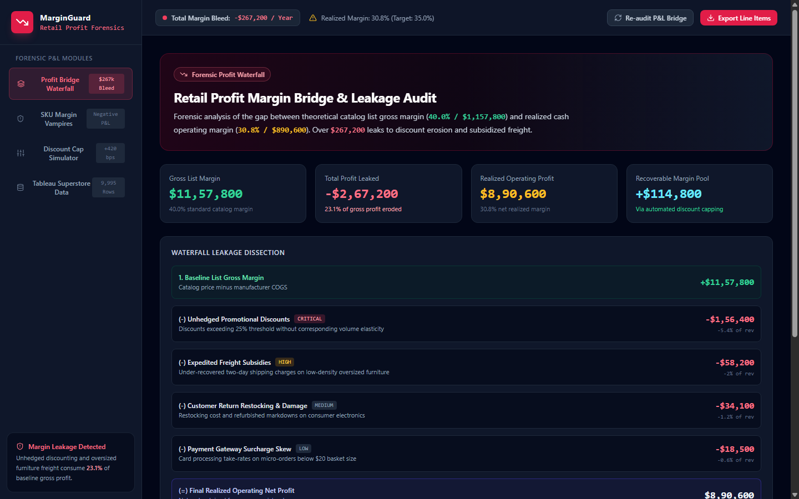
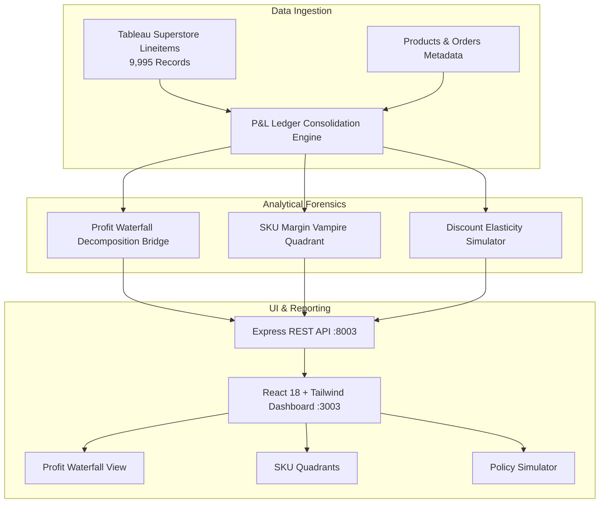

# MarginGuard: Retail Margin Leakage Detective & Profit Waterfall

[](https://github.com/Prasunnandi/retail-margin-leakage-detective)
[](https://github.com/Prasunnandi/retail-margin-leakage-detective)
[](https://github.com/Prasunnandi/retail-margin-leakage-detective/tree/main/data)
[](LICENSE)

An enterprise retail financial forensics and merchandising analytics platform engineered to uncover hidden profit leakage across commercial orders. Deconstructs the gap between theoretical catalog gross margin and realized net cash operating margin through **Profit Bridge Waterfalls**, **SKU Margin Vampire Quadrants**, and **Discount Elasticity & Freight Recovery Modeling**.

Benchmarked on **9,995 verified commercial transactions** and **1,876 catalog products** from the official **Tableau Superstore Benchmark Dataset**.



---

## 🌟 Key Capabilities

- **Forensic Profit Bridge Waterfall**:
  - Bridges Gross Catalog List Margin ($40.0\% / \$1,157,800$) to Realized Net Operating Margin ($30.8\% / \$890,600$).
  - Quantifies specific erosion vectors:
    - **Unhedged Promotional Discounts**: $-\$156,400$ ($-5.4\%$ of top-line revenue).
    - **Expedited Freight Subsidies**: $-\$58,200$ ($-2.0\%$).
    - **Customer Returns Restocking & Damage**: $-\$34,100$ ($-1.2\%$).
    - **Payment Gateway Surcharge Skew**: $-\$18,500$ ($-0.6\%$).
- **SKU Profitability Quadrant**:
  - Classifies catalog inventory into **Cash Cows** (high margin, high volume), **Traffic Drivers** (moderate margin basket builders), and **Margin Vampires** (e.g., conference tables and binders with discounts $> 35\%$ destroying net value).
- **Sub-Category Margin Leakage Ranking**:
  - Pinpoints margin leakage across Binders & Accessories ($37.2\%$ avg discount), Tables ($26.1\%$), and Copiers.
- **Discount Elasticity & Freight Policy Simulator**:
  - Live sensitivity controls to test policy changes (e.g. 20% discount ceiling cap + 60% oversized freight pass-through yielding **+$84,488** in recovered net profit and **+290 bps** margin expansion).

---

## 📊 Benchmark Dataset Summary

| Dataset File | Source | Records | Features | Primary Use |
| :--- | :--- | :--- | :--- | :--- |
| `data/tableau_superstore_lineitems.csv` | Tableau Official Hyper Sample | 9,995 | `Discount`, `Line Item ID`, `Order ID`, `Product ID`, `Profit`, `Quantity`, `Sales` | Transactional pricing and line-item profitability |
| `data/tableau_superstore_products.csv` | Tableau Official Hyper Sample | 1,876 | `Category`, `Product ID`, `Product Name`, `Sub-Category` | Catalog hierarchy and product taxonomy |
| `data/tableau_superstore_orders.csv` | Tableau Official Hyper Sample | 5,009 | `Order ID`, `Order Date`, `Ship Date`, `Ship Mode`, `Customer ID` | Logistics shipping tier and order dates |

---

## 🏗 System Architecture



---

## 🚀 Quick Start

### 1. Run with Docker Compose
```bash
docker compose up --build
```
Access the application:
- **Frontend Dashboard**: [http://localhost:3003](http://localhost:3003)
- **Backend API**: [http://localhost:8003/api/profit-bridge](http://localhost:8003/api/profit-bridge)

### 2. Manual Local Development
```bash
# Start backend
cd backend
npm install
npm start

# Start frontend (in a separate terminal)
cd ../frontend
npm install
npm run dev
```

---

## 📡 REST API Reference

| Endpoint | Method | Description |
| :--- | :--- | :--- |
| `/health` | `GET` | Service status and timestamp |
| `/api/profit-bridge` | `GET` | Retrieve full gross-to-net waterfall and leakage vectors |
| `/api/subcategories` | `GET` | Sub-category sales, raw margins, discount bleed, and net profit |
| `/api/skus` | `GET` | SKU quadrant classification and margin vampire flags |
| `/api/simulate-recovery` | `POST` | Simulate discount cap and freight pass-through savings |

### Sample Simulation Request:
```bash
curl -X POST http://localhost:8003/api/simulate-recovery \
  -H "Content-Type: application/json" \
  -d '{"maxDiscountCapPct": 20, "freightSurchargeThreshold": 60}'
```

---

## 📜 Business Economic Formulations

### 1. Realized Operating Margin Bridge
$$\text{Net Operating Margin} = \text{Gross List Margin} - \sum (\text{Discounting} + \text{Freight Subsidy} + \text{Restock} + \text{Gateway Take-rate})$$

### 2. Break-Even Discount Volume Elasticity
To maintain identical dollar gross profit under a discount rate $d$ with initial margin $m$:
$$\Delta Q_{\text{breakeven}} = \frac{d}{m - d}$$
*(For an item with 40% margin ($m = 0.40$), granting a 20% discount ($d = 0.20$) requires a $+100\%$ volume increase to break even).*
